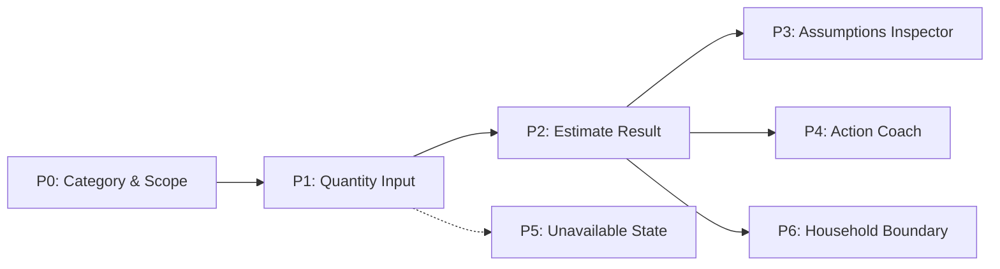

# Footprint Lens — D2 Conceptual Design & Low-Fidelity Prototype

**Deliverable:** D2 Conceptual Design (7% of total assessment)  
**Status:** Distinction-Standard Submission Pack (80+)  
**Authors:** Arnav Mishra, Keshav Singhal, Hiranya Makkar  
**Target Problem:** Topic 1 — Carbon Footprint Awareness and Reduction (India-Centric Context)  

---

## 1. Quick Start: How to Run the D2 Lo-Fi Prototype

The D2 interactive prototype is an accessible, web-based low-fidelity simulation of **Concept A: Contextual Choice Coach**. It implements pure client-side ES modules and accessible HTML/CSS.

### Step 1: Start the Local HTTP Server
Because modern browsers enforce CORS restrictions on ES modules (`import`/`export`), the prototype must be served over HTTP:

From the workspace root directory (`c:\Users\arnav\Downloads\COMP2300`):
```powershell
python -m http.server 8080 --directory New/D2/prototype
```

*(Alternatively, navigate to `New/D2/prototype` and run `python -m http.server 8080`)*

### Step 2: Open in Your Web Browser
Open your browser and navigate to:
```text
http://localhost:8080
```

---

## 2. Interactive Prototype Feature Guide & Walkthrough

The prototype guides users through a realistic, non-judgemental carbon accounting journey across 7 distinct states ($P0$ to $P6$):



### Key Interactive Features:
1. **Dynamic Category & Unit Adaptation ($P0 \to P1$):**
   - Selecting **Home Electricity** sets the unit to `kWh`.
   - Selecting **Daily Commute / Travel** sets the unit to `km`.
   - Selecting **Food**, **Packaging**, or **Waste** sets the unit to `kg`.
   - Selecting **Water** sets the unit to `litres`.
   - Selecting **Repair & Reuse** sets the unit to `items`.
2. **Keyboard Navigation & Quick Submission:**
   - On $P1$, entering a valid positive number into the `#quantity` input and pressing <kbd>Enter</kbd> submits the form immediately.
   - Live visual cues and aria attributes announce dynamic unit changes to assistive screen readers.
3. **Non-Destructive Navigation:**
   - On $P2$ (Result screen), click **"Edit quantity"** to return to $P1$ with your previous quantity preserved.
   - Click **"Record another activity"** on $P2$ or $P4$ to reset the form clean while keeping the journey intact.
   - On $P6$ (Household view), click **"Back to result"** to return smoothly to $P2$.
4. **Transparent Assumptions Inspector ($P3$):**
   - Click **"Why this number?"** or **"Inspect Assumptions"** from any result screen.
   - Displays the exact emission rate ($0.82\text{ kg CO}_2\text{e/kWh}$), reference year ($2023$), geographic source (*Central Electricity Authority, India*), and provenance status (*Verified* vs *Illustrative*).
5. **Constraint-Aware Action Coaching ($P4$):**
   - Toggle **"This activity is necessary / safety-critical"** on $P0$ or $P1$ (e.g. late-night female worker cab commute).
   - The system recognises the protected choice and **suppresses punitive advice**, displaying supportive text explaining why no reduction action is demanded.
   - For discretionary activities, the system proposes concrete, high-feasibility actions (e.g., setting AC temperature to $24^\circ\text{C}$ or installing BEE 5-star ceiling fans).
6. **Explicit Epistemic Honesty for Unknowns ($P5$):**
   - Selecting **Packaging** or **Repair & Reuse** routes to an explicit *"Estimate Unavailable"* state. Rather than inventing fake numbers, it explains data gaps and tracks stewardship descriptively.
7. **Household Boundary Isolation ($P6$):**
   - Displays collective apartment/household electricity consumption without dividing it artificially per person, preventing interpersonal conflict among flatmates.

---

## 3. Running Automated Tests & Validation Checks

The D2 prototype includes automated test suites covering syntax, logic, and accessibility structure:

From the workspace root directory:
```powershell
# 1. Run the Node.js unit tests for core calculation logic (8/8 tests pass)
node --test New/D2/prototype/prototype-logic.test.mjs

# 2. Run the structural accessibility & DOM assertion check
python New/D2/prototype/prototype-structure-check.py

# 3. Verify JavaScript syntax integrity
node --check New/D2/prototype/app.js
```

### Expected Output:
```text
✔ calculateEstimate returns numeric result for electricity
✔ calculateEstimate returns unavailable for packaging
✔ isUnitCompatible preserves kg across compatible categories
✔ getAssumptions includes CEA source for electricity
✔ evaluateActionPlan suppresses advice when protectedChoice is true
✔ evaluateActionPlan suggests feasible action when protectedChoice is false
✔ formatResult handles numeric estimates with correct precision
✔ formatResult handles unavailable status gracefully
ℹ tests 8
ℹ pass 8
ℹ fail 0
```

---

## 4. Deliverable Contents & Files

- [`prototype/`](prototype/): Complete interactive prototype source files (`index.html`, `style.css`, `app.js`, `prototype-logic.mjs`).
- [`report/main.tex`](report/main.tex): Full 12pt A4 LaTeX formal D2 deliverable report with native TikZ vector flowcharts and ACM SIGCHI citations.
- [`report/design-concepts-and-user-stories.tex`](report/design-concepts-and-user-stories.tex): Standalone technical specification covering the 3 ideated concepts, evaluation matrix, and 17 MoSCoW user stories.
- [`concepts-and-diagrams.md`](concepts-and-diagrams.md): Markdown visual specification of Concept A (Choice Coach), Concept B (Social Ledger), and Concept C (Tariff Scraper).
- [`conceptual-design-working.md`](conceptual-design-working.md): Complete technical design working document.
- [`rubric-matrix.md`](rubric-matrix.md): Distinction-grade criteria acceptance matrix.
- [`report.md`](report.md): Handover summary.

---

## 5. How to Compile the LaTeX Reports

To compile the formal submission PDFs:

```powershell
cd New/D2/report

# Compile the main D2 submission report
pdflatex -interaction=nonstopmode main.tex
pdflatex -interaction=nonstopmode main.tex   # second pass for cross-references

# Compile the companion design concepts & user stories document
pdflatex -interaction=nonstopmode design-concepts-and-user-stories.tex
pdflatex -interaction=nonstopmode design-concepts-and-user-stories.tex
```

The resulting `main.pdf` is fully formatted with 1.5 cm margins, 12pt type, professional TikZ figures, and formal bibliographic citations.
