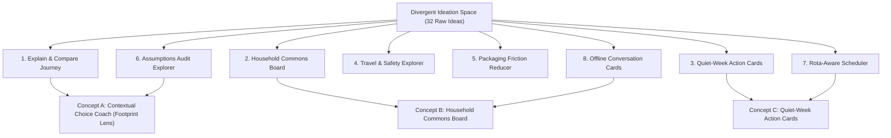
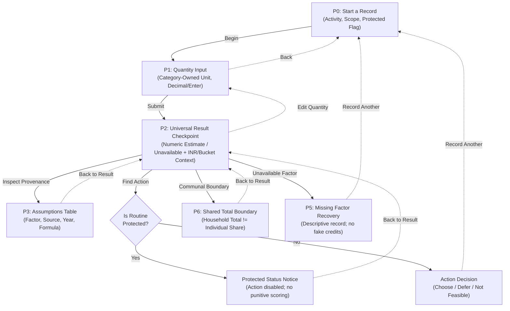
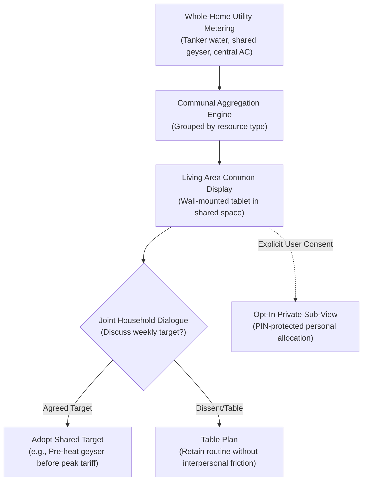
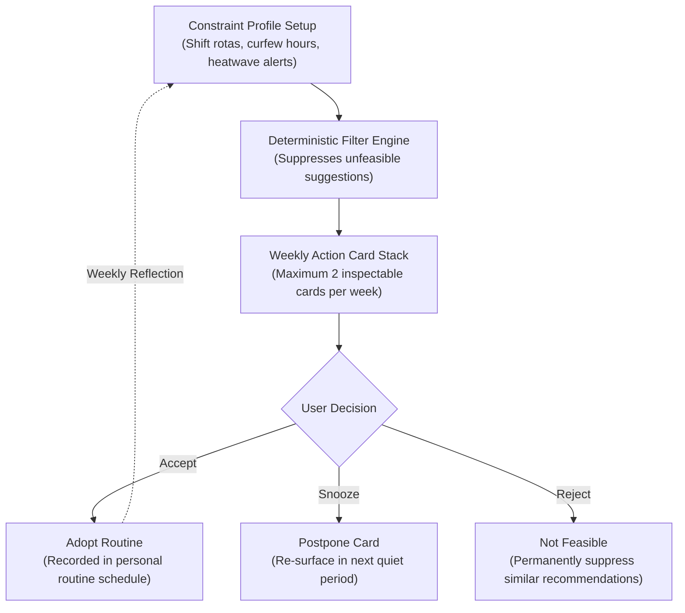

# D2 Concept Sketches, Interaction Diagrams and Selection Evidence

## 1. Divergent Ideation Canvas

To avoid premature fixation on a standard personal carbon dashboard, the team conducted a structured divergent ideation workshop utilizing *Crazy Eights* and *10-plus-10* sketching across the three target personas:
- **Persona 1 (Aanya):** University student in a shared PG/flat with unmetered utilities and split incentives.
- **Persona 2 (Rohan):** Young professional working nocturnal BPO/IT shifts with strict safety travel constraints.
- **Persona 3 (Meera):** Homemaker managing a multi-generational household budget, appliances, and water.

The 32 generated concepts were synthesized into **eight distinct response families**:

---

## 2. Three Distinct Conceptual Models

### Concept A — Contextual Choice Coach (Footprint Lens)
* **Interaction Paradigm:** Micro-decision checkpoint with contextual transparency.
* **Core Loop:** Routine Selection $\rightarrow$ Quantity Input $\rightarrow$ Universal Result Checkpoint $\rightarrow$ Branching (Assumptions, Constraint Action, Communal Boundary, or Missing Factor Recovery).

* **Distinctive Value:** Rather than viewing carbon footprinting as an accounting exercise, Concept A treats the calculation as a *trust checkpoint*. If a factor is illustrative, its provenance is transparently displayed; if a habit is driven by safety or shifts, it is protected from shaming; if a factor is unknown, it is descriptively preserved.

---

### Concept B — Household Commons Board
* **Interaction Paradigm:** Communal resource coordination and consensus dialogue.
* **Core Loop:** Whole-Home Utility Aggregation $\rightarrow$ Common Living Room Display $\rightarrow$ Joint Household Discussion $\rightarrow$ Consented Private View.

* **Distinctive Value:** Solves the multi-tenant split incentive (L1) and intergenerational friction (L2) by rejecting individual blame. It acknowledges that in Indian households, large energy loads (air conditioning, refrigerators, geysers) are communal.
* **Key Risk:** Building verified consent models and fair sub-metering algorithms is technically difficult for a small desktop MVP.

---

### Concept C — Quiet-Week Action Cards
* **Interaction Paradigm:** Asynchronous, low-friction constraint nudges.
* **Core Loop:** One-time Constraint Setup $\rightarrow$ Deterministic Filtering $\rightarrow$ Maximum 2 Cards / Week $\rightarrow$ Action Decision $\rightarrow$ Weekly Reflection.

* **Distinctive Value:** Minimizes user cognitive load (S3). Users do not have to perform daily logging; the system respects their attention and constraints.
* **Key Risk:** Without activity logging, users cannot visualize the concrete magnitude of their routines or verify calculation assumptions.

---

## 3. Multi-Criteria Decision Matrix (MCDM)

| Criterion | Weight | Concept A (Choice Coach) | Concept B (Commons Board) | Concept C (Quiet Cards) |
|---|:---:|:---:|:---:|:---:|
| **D1 Must Epic Coverage (E1--E5)** | 25% | **5.0/5.0:** Fully satisfies E1--E5 in a single walkthrough. | **3.0/5.0:** Weak on individual action (E3) and brief logging (E5). | **3.0/5.0:** Lacks assumption inspection (E2) and category breadth (E4). |
| **Stakeholder Fit (P1--P3)** | 25% | **4.5/5.0:** Fits flatshares (P1), shift workers (P2), and families (P3). | **4.0/5.0:** Strong for families, invasive for flatmates. | **3.5/5.0:** Strong for shift workers, limited for general tracking. |
| **Technical Feasibility** | 20% | **5.0/5.0:** Deterministic business logic; clean JavaFX MVP. | **2.5/5.0:** Requires complex multi-user sync and shared auth. | **3.5/5.0:** Requires notification daemon and scheduler state. |
| **Scientific Provenance** | 15% | **5.0/5.0:** Dedicated P3 assumptions table with factor transparency. | **3.0/5.0:** Aggregation obscures calculation formulas. | **2.5/5.0:** Recommendations detached from quantitative data. |
| **Risk Profile** | 15% | **4.5/5.0:** Low risk; false precision mitigated by disclaimers. | **2.0/5.0:** High privacy and interpersonal coercion risk. | **3.0/5.0:** Risk of perceived black-box advice. |
| **Weighted Total** | **100%** | **4.65 / 5.00 (Selected)** | **3.00 / 5.00** | **3.20 / 5.00** |

---

## 4. Competitor Differentiation Matrix

| Dimension | Earth Hero / Klima | UN Carbon Calculator | Capture / Giki Zero | Footprint Lens (Concept A) |
|---|---|---|---|---|
| **Emission Factor Transparency** | Hidden backend constants; single total. | National averages; hidden formula. | Proprietary algorithm; gamified score. | **Inspectable Provenance:** Full factor, source, year, and formula on P3. |
| **Constraint / Safety Protection** | Flat penalty; lectures users on car use. | Static questionnaire; ignores shift rotas. | Badges penalize necessary travel. | **Protected Flag:** Safety, night shifts, and heat disable punitive advice. |
| **Communal Scope Integrity** | Divides utility bills equally by residents. | Linear division by household count. | Assumes individual owns all bills. | **Communal Boundary:** Household totals never attributed to one resident. |
| **Circular / Indigenous Habits** | Fabricates carbon credits or ignores repair. | Only tracks flights, cars, and diet. | Requires bank transaction sync. | **Descriptive Logging:** Circular repair/reuse logged without fake credits. |
| **Algorithmic Transparency** | Proprietary behavioral AI nudges. | Static tips. | Black-box behavioral scoring. | **Deterministic Engine:** 100% open, auditable, non-speculative rules. |
