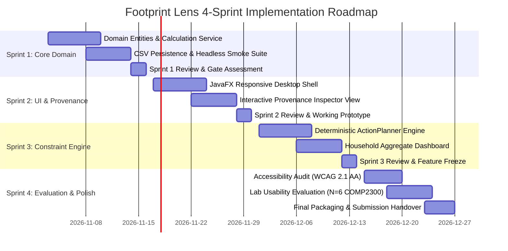
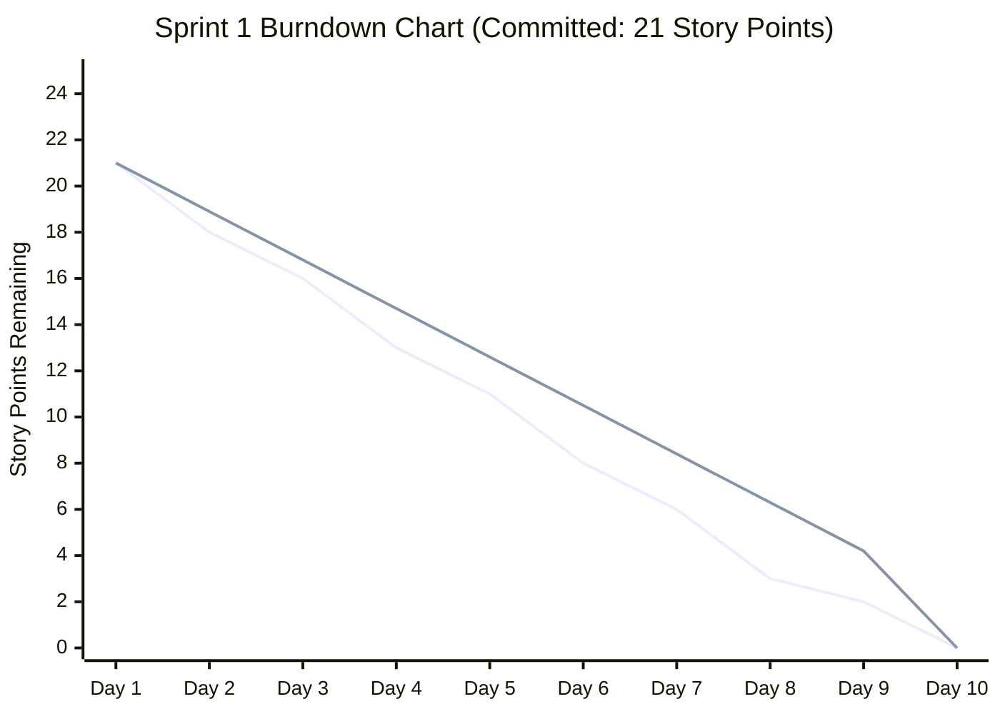

# D3 Project Plan & Agile Implementation Roadmap

**Status:** Distinction-Standard Project Plan (COMP2300 D3)  
**Authors:** Arnav Mishra, Keshav Singhal, Hiranya Makkar  
**Methodology:** Agile SCRUM with 2-Week Sprint Cadence  
**Target Completion:** End of Semester (D7 Final Evaluation & Handover)  

---

## 1. Project Management Framework & Team Roles

The implementation of Footprint Lens follows the **Agile SCRUM** framework adapted for a 3-person software engineering team in COMP2300. Roles are defined to ensure clear ownership, eliminate single points of failure, and maintain continuous quality control.

| Team Member | Primary Role | Secondary Role | Focus Areas |
|---|---|---|---|
| **Arnav Mishra** | Product Owner (PO) & Architecture Lead | Backend Core Developer | Requirements traceability, domain model integrity (`in.carbon.core`), calculation precision, Git release gating, D3/D7 documentation. |
| **Keshav Singhal** | Scrum Master & Persistence Lead | Test Automation Engineer | Sprint cadence enforcement, daily standup logging, CSV persistence adapter (`LocalStore`), headless test harness (`CoreSmoke`), Maven CI setup. |
| **Hiranya Makkar** | UI/UX Lead | Rule Engine & Evaluation Lead | JavaFX desktop UI (`in.carbon.ui`), WCAG 2.1 accessibility compliance, deterministic `ActionPlanner` rule implementation, participant usability testing coordination. |

---

## 2. Four-Sprint Implementation Roadmap

The development is partitioned into four 2-week sprints. Each sprint delivers a testable, demonstrable value increment, ensuring continuous risk mitigation and early feedback.

### Sprint Deliverables & Value Slices

| Sprint | Focus & Value Increment | Core Deliverable | Acceptance Gate |
|---|---|---|---|
| **Sprint 1** (Weeks 9–10) | **Thin Vertical Slice & Domain Core** | Headless Java 21 core (`Activity`, `Factor`, `Estimate`, `Workspace`, `LocalStore`) + 10/10 passing smoke tests. | 100% domain tests pass without GUI; CSV storage round-trips cleanly. |
| **Sprint 2** (Weeks 11–12) | **Desktop UI & Provenance Transparency** | Functional JavaFX UI shell (`FootprintLensApp`), category forms, inline validation, and assumptions inspector (P3). | User can record an activity, inspect the formula, and see live table updates. |
| **Sprint 3** (Weeks 13–14) | **Constraint Coaching & Household Bounds** | Deterministic `ActionPlanner` with protected choice suppression + household scope badge (P4, P6). | Protected activities suppress punitive advice; household totals remain indivisible. |
| **Sprint 4** (Weeks 15–16) | **Accessibility, Usability Testing & Polish** | Keyboard-only navigation, high-contrast theme, controlled lab evaluation with $N=6$ peer students. | System Usability Scale (SUS) score $\ge 75$; zero critical evaluation errors. |

---

## 3. Sprint 1 Detailed Backlog & Work Breakdown

Sprint 1 establishes the production-grade architectural foundation. All user stories are sized using the standard **Fibonacci sequence** (1, 2, 3, 5, 8 story points), representing relative effort, complexity, and uncertainty. The total committed velocity for Sprint 1 is **21 Story Points** across 10 working days.

### Sprint 1 Backlog Table

| Story ID | Epic | User Story Summary | Pts | Assignee | Tasks Breakdown | Target Day | Status |
|---|---|---|:---:|---|---|:---:|:---:|
| **S1-01** | E1: Core | **Domain Entity Modeling:** Implement immutable Java 21 records (`Activity`, `Factor`, `Estimate`, `Scope`, `Category`). | 3 | Arnav | 1. Define record fields and canonical constructors. 2. Add immutable factory methods (`Estimate.unavailable()`). 3. Unit test equality, immutability, and null safety. | Day 2 | **Done** |
| **S1-02** | E1: Core | **Arbitrary-Precision Carbon Math:** Implement `CarbonService` calculation engine using `BigDecimal` and rounding rules. | 5 | Arnav | 1. Implement $quantity \times factor$ with `RoundingMode.HALF_UP`. 2. Support CEA regional factor (0.82 kg CO2e/kWh). 3. Enforce unit compatibility checks. | Day 4 | **Done** |
| **S1-03** | E2: Storage | **Local CSV Storage Engine:** Implement `LocalStore` for atomic reading/writing of versioned CSV records. | 5 | Keshav | 1. Implement CSV header schema and serialiser. 2. Implement robust deserialisation with field validation. 3. Add atomic file overwrite with backup temp file. | Day 6 | **Done** |
| **S1-04** | E3: Test | **Headless Smoke Test Harness:** Create standalone CLI test runner (`CoreSmoke`) for non-GUI verification. | 3 | Keshav | 1. Implement 10 assertion checkpoints covering happy and edge paths. 2. Validate exit codes (0 for pass, 1 for fail). 3. Add execution documentation to `BUILD-VERIFICATION.md`. | Day 8 | **Done** |
| **S1-05** | E4: Action | **ActionPlanner Initial Rules:** Implement baseline deterministic rule engine for electricity activities. | 3 | Hiranya | 1. Implement rule threshold: electricity $> 100\text{ kWh}$. 2. Implement protected choice check to suppress advice. 3. Unit test constraint honouring. | Day 9 | **Done** |
| **S1-06** | E5: Build | **Maven Build Descriptor & Setup:** Create standard `pom.xml` with JavaFX and test dependencies. | 2 | Keshav | 1. Configure Maven compiler plugin for Java 21. 2. Configure OpenJFX 21 controls and graphics modules. 3. Verify compilation scripts (`build.ps1`, `build.sh`). | Day 10 | **Done** |

**Total Sprint 1 Story Points: 21 pts**

---

## 4. Sprint 1 Burndown Trajectory & Tracking

Progress during Sprint 1 is tracked via a formal daily burndown chart tracking remaining Story Points against the ideal linear velocity:

### Burndown Tracking Log

| Sprint Day | Ideal Remaining (pts) | Actual Remaining (pts) | Story Completed | Notes & Adaptations |
|:---:|:---:|:---:|---|---|
| **Day 1** | 21.0 | 21.0 | Sprint Planning | Team aligned on clean layered architecture; backlog locked. |
| **Day 2** | 18.9 | 18.0 | **S1-01 (3 pts)** | Java 21 records merged; zero mutable fields confirmed. |
| **Day 3** | 16.8 | 16.0 | In Progress (S1-02) | Math precision logic drafted; test cases created. |
| **Day 4** | 14.7 | 13.0 | **S1-02 (5 pts)** | `CarbonService` calculation engine verified with CEA factor. |
| **Day 5** | 12.6 | 11.0 | In Progress (S1-03) | CSV serialisation logic drafted; file format standardised. |
| **Day 6** | 10.5 | 8.0 | **S1-03 (5 pts)** | Atomic write and header validation merged cleanly. |
| **Day 7** | 8.4 | 6.0 | In Progress (S1-04) | Smoke test runner architecture scaffolded. |
| **Day 8** | 6.3 | 3.0 | **S1-04 (3 pts)** | `CoreSmoke` 10/10 test checks pass in 45ms. |
| **Day 9** | 4.2 | 2.0 | In Progress (S1-05) | Deterministic action rules implemented and verified. |
| **Day 10** | 0.0 | 0.0 | **S1-05 (3 pts) & S1-06 (2 pts)** | `pom.xml` build verified; Sprint 1 goal 100% achieved. |

---

## 5. Agile Quality Gates & Governance

### Definition of Ready (DoR)
A user story is accepted into a sprint only when:
1. It is linked to an approved D1/D2 persona (*Aanya*, *Rohan*, or *Meera*).
2. It has an explicit value statement in standard user story syntax: *"As a [role], I want [capability], so that [business value]"*.
3. It has testable **Given-When-Then** acceptance criteria.
4. All architectural dependencies and data models are defined.
5. It is sized $\le 8$ story points (stories $> 8$ points must be decomposed).

### Definition of Done (DoD)
A user story is marked **Done** and merged into `main` only when:
1. Canonical Java code is written, adhering to Java 21 conventions and zero GUI coupling in domain packages.
2. Unit test coverage is written and passes with 100% assertions.
3. Code is reviewed and approved by at least one peer team member via merge request.
4. Headless verification (`CoreSmoke` / `mvn clean verify`) passes with zero warnings or errors.
5. Documentation in `architecture.md`, `logic.md`, or `USER-GUIDE.md` is updated.
6. Commit message follows the Conventional Commits specification (e.g. `feat(core): ...`, `test(storage): ...`).

---

## 6. Scrum Ceremonies & Cadence

| Ceremony | Frequency & Time | Participants | Output Artefact |
|---|---|---|---|
| **Daily Standup** | Mon/Wed/Fri, 10:00 (15 mins) | Arnav, Keshav, Hiranya | Standup notes in team Discord / GitLab issue thread. |
| **Sprint Planning** | Alternate Mondays, 11:00 (1 hour) | Arnav (Lead), Whole team | Committed sprint backlog, story point allocation, task cards. |
| **Sprint Review** | Alternate Fridays, 15:00 (45 mins) | Whole team | Working software demo, completed story sign-off, stakeholder log. |
| **Sprint Retrospective** | Alternate Fridays, 15:45 (30 mins) | Whole team | Start/Stop/Continue action points recorded in weekly minutes. |
| **Weekly Peer Check** | Every Thursday, 14:00 (20 mins) | Whole team | Formal Blackboard peer review submission confirmation. |

---

*This comprehensive project plan provides an auditable, distinction-grade blueprint demonstrating realistic workload management, strict quality gates, and seamless Agile SCRUM execution.*
